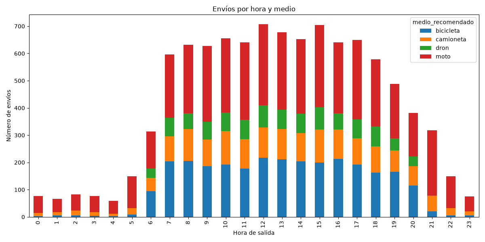

# Análisis del dataset de envíos

## Actividad 1 — El retrato del dataset

**Contenido:** [Predicción](#predicción) · [Resultado](#resultado) · [Comparación](#comparación) · [Respuestas](#respuestas) · [Para pensar](#para-pensar)

---

### Predicción

| # | Pregunta | Predicción y razón |
|---|----------|--------------------|
| 1 | Cuando llueve, ¿qué medio domina? | **Camioneta**, porque así tanto los paquetes como el conductor se resguardan de posibles daños |
| 2 | En el centro de la ciudad, ¿qué medio domina? | **Bicicleta o moto**, porque es más práctico para evitar el tráfico; la decisión dependería del volumen del paquete |
| 3 | ¿Cuál es la distancia más larga que recorre una bicicleta? | **Aprox. 7 km**, porque una persona en bicicleta tardaría demasiado a más de esa distancia, además de que no puede llevar paquetes demasiado grandes |
| 4 | ¿Cuántos envíos tienen una etiqueta que rompe las reglas del negocio? | **0**, porque se supone que el modelo siempre sigue las reglas y si algo no encaja al 100 % lo envía al valor más cercano |

---

### Resultado

#### Dominio por clima (% por fila)

```text
medio_recomendado  bicicleta  camioneta  dron  moto
clima
despejado               32.8       16.6  13.5  37.1
lluvia                   8.5       16.7   0.0  74.8
viento_fuerte           31.7       18.4   0.0  49.9
```

#### Dominio por zona (% por fila)

```text
medio_recomendado  bicicleta  camioneta  dron  moto
zona_destino
centro                  58.4       13.5   0.0  28.0
periferia                0.9       14.0  12.6  72.5
residencial             26.2       14.6  17.3  41.9
rural                    0.0       40.8   0.0  59.2
```

#### Resumen por medio (min / mediana / max)

```text
                  distancia_km               peso_kg               volumen_l
                           min median    max     min median    max       min median     max
medio_recomendado
bicicleta                 0.37   3.42   7.00     0.1   1.76   7.99       0.3   7.78   39.70
camioneta                 0.43   8.99  59.12     0.1   6.72  80.00       0.3  31.36  400.57
dron                      2.07   9.54  14.99     0.1   1.04   2.50       0.3   4.29   11.98
moto                      0.34  10.63  39.90     0.1   2.58  24.93       0.3  11.27   89.99
```

#### Etiquetas que rompen las reglas

```text
Etiquetas imposibles 0
Empty DataFrame
Columns: [id_envio, medio_recomendado]
Index: []
```

#### Distancia por zona (km)

```text
                min  median    max
zona_destino
centro         0.34    2.79   5.91
periferia      5.23   15.75  29.39
residencial    1.06    6.98  14.80
rural         15.93   34.20  59.12
```

#### Camionetas con distancia menor a 2 km

```text
Total: 107
Con razón clara: 95
Sin razón clara: 12
      distancia_km  peso_kg  volumen_l  fragil  prioridad trafico          clima  valor_declarado_mxn
228           0.98     0.84       2.26       0  mismo_dia    bajo      despejado               295.93
1548          1.66     3.71      13.04       0    express   medio      despejado              1042.89
2736          1.74     0.95       7.32       0     normal   medio         lluvia              1061.89
3302          1.17     1.17       8.09       1    express    bajo         lluvia               380.71
3425          1.95     2.00      14.41       0     normal    alto      despejado               300.61
4962          1.53    19.72      60.55       1     normal    alto      despejado               364.46
5593          1.95    24.45      48.11       1     normal    bajo         lluvia               129.18
6797          1.34     6.51      13.14       0    express    alto  viento_fuerte               531.07
6859          1.77     0.80       3.17       1    express    bajo      despejado              1643.56
7208          1.71     0.61       3.06       1     normal    bajo      despejado               471.93
8264          1.68     2.23       6.31       1    express    alto  viento_fuerte               673.66
9491          1.20     1.33       9.96       0    express    alto         lluvia               475.32
```
f
---

### Comparación

#### Predicción 1 — Medio dominante cuando llueve

- **Predije:** que en lluvia la mejor opción sería la camioneta.
- **El resultado fue:** moto, con 74.8 %.
- **Fallé** porque la camioneta solo tiene 16.7 % de ser elegida.
- **Lo que no había considerado:** me fui por lo fácil, la protección del paquete, pero el modelo no toma en cuenta eso, sino qué medio es más barato para transportar. Viéndolo así, tiene sentido que sea la moto, y la camioneta solo se usaría en paquetes grandes.

#### Predicción 2 — Medio dominante en el centro

- **Predije:** que en el centro la mejor opción sería moto o bicicleta.
- **El resultado fue:** bicicleta con 58.4 % y moto con 28 %.
- **Acerté** porque son los dos medios con mayor probabilidad de ser seleccionados por el modelo si el paquete va al centro.
- **Lo que no había considerado:** si el paquete es refrigerado, tiene que ser camioneta sí o sí, por lo que no se puede descartar que sean camionetas.

#### Predicción 3 — Distancia máxima de la bicicleta

- **Predije:** que la bicicleta tendría una distancia máxima de 7 km.
- **El resultado fue:** 7 km.
- **Acerté** porque el máximo sí fue de 7 km.
- **Lo que no había considerado:** mi predicción se basó meramente en el README.

#### Predicción 4 — Etiquetas que rompen las reglas

- **Predije:** 0.
- **El resultado fue:** 0 etiquetas imposibles.
- **Acerté** porque no hubo etiquetas imposibles.
- **Lo que no había considerado:** no se marcan imposibles porque se asigna el vehículo más cercano considerando los datos. Es decir, el generador solo elige entre medios posibles y, si hay ruido, se cambia a un medio posible.

---

### Respuestas

#### 3.1 — ¿Dónde y cuándo nunca aparece el dron?

- **Zonas donde el dron vale 0.0:** Centro y Rural.
  - **Regla que lo explica:** hay una regla explícita que dice `medio == "dron" and paquete["zona_destino"] == "centro"`, por lo que el dron nunca irá al centro.
- **Climas donde el dron vale 0.0:** lluvia y viento fuerte.
  - **Regla que lo explica:** la regla explícita es `medio == "dron" and paquete["clima"] != "despejado"`. Esta regla impide que el dron viaje con un clima que no sea despejado.
- **Caso raro (zona rural):** ninguna regla de zona lo prohíbe y aun así vale 0.0. ¿Qué otra restricción del dron lo explica?
  - **Respuesta:** esto pasa porque la zona rural se encuentra a más de 15 km, que es la distancia máxima del dron.

#### 3.2 — ¿Por qué la bicicleta casi no va a la periferia?

- **Columna que lo explica:** porque abarca más del límite que puede recorrer la bicicleta, en la columna `distancia_km`.
- **Número que lo demuestra** (distancia mediana por zona frente al límite de 7 km de la bicicleta): 15.75 km, por lo que es claramente mayor que el límite máximo que puede alcanzar la bicicleta.
- **Explicación:** al abarcar bastante terreno, en periferia la distancia mínima es 5.23 km y la mediana 15.75 km, ambas por encima o cerca del límite de 7 km de la bicicleta, por lo que no puede ir a esas zonas. Además, solo 46 envíos están a menos de 7 km.

#### 3.3 — Máximos contra la tabla LIMITES

| Medio | Distancia máx. (límite) | Peso máx. (límite) | Volumen máx. (límite) |
|---|---|---|---|
| Bicicleta | 7.00 (7) | 7.99 (8) | 39.70 (40) |
| Dron | 14.99 (15) | 2.50 (2.5) | 11.98 (12) |
| Moto | 39.90 (40) | 24.93 (25) | 89.99 (90) |
| Camioneta | 59.12 (1000) | 80.00 (1000) | 400.57 (3000) |

- **Límites que se pueden adivinar mirando los datos:** los límites de la bicicleta, del dron y de la moto.
- **Límite que no se puede adivinar:** los de la camioneta.
- **Por qué:** porque los datos obtenidos no están cerca de los límites que puede alcanzar. Como en el peso: el máximo del dataset es de 80 kg y la camioneta soporta un máximo de 1 000 kg. Ningún paquete llega a ese límite, por lo cual pensaríamos que el límite es 80.

#### 3.4 — Camionetas en viajes de menos de 2 km

- **Total de camionetas con distancia menor a 2 km:** 107 camionetas.
- **Cuántas tienen una razón clara** (refrigerado, o peso/volumen que la moto no soporta): 95.
- **Cuántas no la tienen:** 12.
- **Explicación para las que no:** hay algunas que son express y algunas que son frágiles, lo que penaliza a moto, bicicleta y dron, por lo cual esas podrían ser las razones:
  - **Frágiles:** 6 de las 12 (50 %), contra 19.7 % en todo el dataset.
  - **Express:** 6 de las 12 (50 %), contra 30.4 % en todo el dataset.
  - **El resto** no tiene ninguna de esas características, y ahí aplicaría el ruido.

---

### Para pensar

> Si les dieran solo el CSV, sin las reglas, ¿podrían reconstruir las reglas del negocio a partir de los datos?

- **Reglas que sí se pueden reconstruir:** a partir de los datos sí se podrían reconstruir las reglas de los vehículos, como la bici, la moto y el dron, ya que no son muy complejas y, viendo y analizando, se podría llegar a la conclusión aproximada o correcta.
- **Reglas que no:** en mi opinión, las reglas de la camioneta, ya que con los datos no se alcanza el máximo de sus capacidades, por lo cual podríamos asumir cosas que no son en cuanto a los refrigerados, la distancia y el peso máximo.
- **Riesgo de dejar que un modelo «descubra» las reglas en lugar de escribirlas a mano:** se puede omitir información importante y asumir que así debe ser por falta de datos, mientras que si se tienen las reglas bien definidas se cubren los casos como se planean.
- **Mi postura:** yo creo que es mejor definir las reglas desde antes para poder obtener los resultados que esperamos, cubriendo los escenarios posibles como los planteamos y no adivinando.

---

## Actividad 2 — La hora y el dron

### Predicción

- **¿Cuántos drones salen a las 3:00?**
  - **Mi predicción:** creo que no saldrán drones.
  - **Por qué lo creo:** porque el dron no trabaja en esas horas ni durante la noche.
- **¿Qué porcentaje de los envíos sale de noche (antes de las 6:00 o desde las 21:00)?**
  - **Mi predicción:** creo que menos del 20 %.
  - **Por qué lo creo:** porque el dron no vuela de noche, por lo que no saldrán pedidos de dron, y no es común que salgan bicicletas de noche.

### Resultado

#### Envíos por hora y medio

```text
medio_recomendado  bicicleta  camioneta  dron  moto
hora_salida                                        
0                          2         12     0    63
1                          6         11     0    49
2                          5         19     0    59
3                          4         13     0    60
4                          2         10     0    47
5                          8         25     0   116
6                         94         50    33   136
7                        204         92    68   233
8                        205        118    57   252
9                        187         97    65   279
10                       192        123    68   273
11                       178        107    72   283
12                       217        111    82   297
13                       211        112    70   284
14                       204        103    72   274
15                       199        122    81   303
16                       213        108    59   260
17                       192         97    69   292
18                       162         97    72   248
19                       166         78    45   199
20                       115         72    35   160
21                        20         58     0   240
22                         5         28     0   116
23                         5         15     0    55
```

#### Porcentaje de envíos de noche

```text
Envíos de noche: 1053
Envíos de día: 8947
Porcentaje de noche: 10.53 %
```

#### Gráfica



### Comparación

| | Mi predicción | Resultado real | ¿Acerté? |
|---|---|---|---|
| Drones a las 3:00 | 0 | 0 | Sí |
| % de envíos de noche | < 20 % | 10.53 % | Sí |

- **Qué me sorprendió o por qué fallé:** que las motos son el vehículo que más trabaja de noche y que las bicicletas casi desaparecen en esas horas.

### Respuestas

#### 2.1 — ¿En qué horas no hay ni un solo dron? ¿Coincide exactamente con la regla?

- **Horas sin ningún dron:** 0, 1, 2, 3, 4, 5, 21, 22 y 23 h.
- **¿Coincide con la regla (solo de 6:00 a 20:59)?** Sí, coincide con la regla del horario del dron.
- **Explicación:** la regla solo permite que el dron trabaje en cierto horario, por lo que en las demás horas no hay ningún dron trabajando.

#### 2.2 — ¿Cuántos envíos de noche hay comparados con los de día? ¿Qué consecuencia tiene para lo que el modelo puede aprender sobre la noche?

- **Envíos de noche:** 1 053 envíos.
- **Envíos de día:** 8 947 envíos.
- **Consecuencia para el modelo:** el modelo tiene muy pocos ejemplos de la noche, por lo que le puede costar saber qué hacer en esas situaciones.

#### 2.3 — Entre las 20:00 y las 21:00 las bicicletas casi desaparecen y las motos aumentan. ¿Qué lo explica según el README.md?

- **Qué dice el README.md:** que la noche penaliza a las bicicletas, por lo que es normal que las motos se lleven los paquetes que deberían ser para bicicleta.
- **Explicación con mis palabras:** las motos son una mejor opción de noche, por eso las bicicletas se ven muy reducidas.

#### 2.4 — ¿Por qué a un árbol le cuesta representar «de noche»? ¿Cuántas preguntas sobre la hora necesitaría como mínimo?

- **Por qué le cuesta:** porque la noche son dos tramos separados.
- **Número mínimo de preguntas y cuáles serían:** creo que un mínimo de 2 preguntas:
  1. ¿Hora ≥ 21?
  2. ¿Hora ≤ 5?

### Para pensar

> Diseñen una columna nueva que le facilite al árbol entender la noche. Expliquen cómo la calcularían con las columnas existentes y cómo comprobarían, con un número, que de verdad ayudó.

- **Nombre de la columna:** `es_noche`.
- **Cómo la calcularía a partir de las columnas existentes:**

  ```python
  es_noche = ((datos["hora_salida"] <= 5) | (datos["hora_salida"] >= 21)).astype(int)
  ```

- **Por qué le ayuda al árbol:** porque el árbol necesita una sola pregunta (`¿es_noche = 1?`) en lugar de dos cortes sobre la hora.
- **Cómo comprobaría con un número que ayudó:** entrenando el mismo árbol con y sin `es_noche`, con los mismos envíos de prueba (`random_state=42`), y comparando la exactitud.
- **Resultado si lo implementé** (`actividad2_noche.py`):

  | Modelo | Exactitud |
  |---|---|
  | Sin `es_noche` | 92.10 % |
  | Con `es_noche` | 92.95 % |

  Mejoró poco (+0.85 puntos), ya que el árbol ya diferenciaba bien la noche; la columna solo lo hizo más simple.

---

## Actividad 3 — Anatomía de los errores

### Predicción

- **¿Qué confusión será la más frecuente?**
  - **Mi predicción:** creo que sería entre moto y bicicleta.
  - **Por qué lo creo:** si el horario es normal y los kilómetros no son muchos, se pueden llegar a confundir una con otra.
- **¿El modelo confundirá alguna vez una bicicleta con una camioneta?**
  - **Mi predicción:** creo que no, aunque sí podría pasar al revés: que un envío de bicicleta lo mande en camioneta.
  - **Por qué lo creo:** las métricas que menciona el README no hacen posible que un envío se mande en bicicleta cuando debería ir en camioneta.

### Resultado

#### Errores del modelo sobre los 2 000 envíos de prueba

```text
Total de errores: 158
real       predicho 
moto       bicicleta    46
camioneta  moto         32
moto       dron         29
bicicleta  moto         20
dron       bicicleta    18
camioneta  bicicleta     9
           dron          4
```

#### Moto que el modelo mandó a dron

```text
Moto mandada a dron: 29
De noche: 26
Dron imposible (las reglas lo corregirían): 26
Dron posible (las reglas no lo corrigen): 3
      distancia_km  peso_kg  volumen_l  fragil prioridad      clima  hora_salida trafico  valor_declarado_mxn
2484          7.35     1.67       5.72       0   express  despejado 17    alto               388.86
3722         12.14     0.90       3.68       0    normal  despejado 13    alto               455.58
677           7.55     1.05       6.60       0    normal  despejado 18    alto               315.50
```

#### Moto que el modelo mandó a bicicleta

```text
Moto mandada a bicicleta: 46
count    46.00
mean      4.08
std       1.45
min       1.35
25%       2.80
50%       3.88
75%       5.30
max       6.89

                     moto->bici (error)  bici acertadas
distancia_km                       4.08            3.55
peso_kg                            2.37            2.16
volumen_l                          9.96           10.13
hora_salida                       12.98           12.84
valor_declarado_mxn             1897.38         1854.89
fragil                             0.35            0.29

prioridad
           moto->bici (error)  bici acertadas
prioridad                                    
express                  0.30            0.30
mismo_dia                0.48            0.12
normal                   0.22            0.58

clima
               moto->bici (error)  bici acertadas
clima                                            
despejado                    0.52            0.85
lluvia                       0.24            0.02
viento_fuerte                0.24            0.13

trafico
         moto->bici (error)  bici acertadas
trafico                                    
alto                   0.35            0.41
medio                  0.33            0.30
bajo                   0.33            0.29

zona_destino
              moto->bici (error)  bici acertadas
zona_destino                                    
centro                      0.57            0.64
residencial                 0.41            0.35
periferia                   0.02            0.01
```

#### Camioneta real que el modelo mandó a otro medio

```text
Camioneta real mal predicha: 45
Refrigerados: 0
Predicción imposible (las reglas lo corregirían): 3
Predicción posible (las reglas no lo corrigen): 42
```

### Comparación

| | Mi predicción | Resultado real | ¿Acerté? |
|---|---|---|---|
| Confusión más frecuente | moto a bicicleta | moto a bicicleta (46) | Sí |
| ¿Bicicleta confundida con camioneta? | No (camioneta → bicicleta); sí (bicicleta → camioneta) | 9 (camioneta → bicicleta); 0 (bicicleta → camioneta) | No |

- **Qué me sorprendió o por qué fallé:** me sorprendió que sí se confunden camionetas con bicicletas, y en eso fue en lo que fallé. También que al revés (bicicleta → camioneta) no hubo ningún caso.

### Respuestas

#### 3.1 — ¿Cuántos errores hay y cuáles son las tres confusiones más frecuentes? ¿Son entre medios parecidos o muy distintos? ¿Qué me dice eso?

- **Total de errores:** 158.
- **Las tres confusiones más frecuentes:**
  1. moto a bicicleta, con 46.
  2. camioneta a moto, con 32.
  3. moto a dron, con 29.
- **¿Medios parecidos o muy distintos?** Son medios que sí se parecen, ya que son vecinos en capacidad, y la moto es el medio intermedio que aparece en casi todos los errores.
- **Qué me dice eso:** que al modelo le faltan ejemplos y se podrían mejorar algunas reglas, aunque estos errores también se pueden deber al ruido.

#### 3.2 — Envíos que eran moto y el modelo mandó a dron

- **Cuántos son:** 29.
- **Cuántos son de noche:** 26.
- **Cuáles corregirían las reglas del negocio y cuáles no:** las 26 de noche serán corregidas, pero las otras 3 no.
- **Qué tienen en común los que no se corrigen:** todos tienen tráfico alto y clima despejado, pasan los 7 km y son de la tarde.

#### 3.3 — Envíos que eran moto y el modelo mandó a bicicleta

- **¿Están cerca del límite de 7 km?** No. La media es de 4.08 km y solo uno se acerca a los 7 km, con 6.89 km.
- **Qué columnas los distinguen de las bicicletas que el modelo sí acertó:** las columnas categóricas, no las numéricas:
  - **`prioridad`:** `mismo_dia` aparece en 48 % de los errores contra 12 % de las bicicletas acertadas, y `normal` en 22 % contra 58 %.
  - **`clima`:** `lluvia` aparece en 24 % de los errores contra 2 % de las bicicletas acertadas.
  - **Explicación (según el README):** en un envío de `mismo_dia` cada minuto pesa casi siete veces más, y la lluvia y el viento frenan a la bicicleta y a la moto. Entonces, aunque la bicicleta sea posible y barata, un envío urgente o con mal clima suele resolverse con una moto. El modelo se equivoca porque la decisión depende de combinar prioridad con clima, y esa combinación le cuesta aprenderla.

#### 3.4 — ¿Qué pasaría con mi análisis si usara otro `random_state`?

- **Respuesta:** creo que cambiarían un poco los resultados, ya que los datos analizados serían diferentes, pero en esencia la base sería la misma y podría llegar a las mismas conclusiones. Además, el modelo ya habría visto algunos de esos datos al entrenar, por lo que la exactitud saldría inflada.

### Para pensar

> Si solo pudieran arreglar un tipo de error, ¿cuál elegirían y por qué? ¿Lo arreglarían cambiando el modelo, los datos o las reglas del negocio?

- **Error que arreglaría:** los envíos que eran moto y el modelo mandó a dron.
- **Por qué:** porque 26 de los 29 son de noche, una hora en la que el dron no puede volar. Además es un error costoso, porque se sugeriría un medio que no puede operar.
- **Cómo lo arreglaría (modelo, datos o reglas del negocio):** con las reglas del negocio. La función `es_posible` ya descarta al dron de noche, así que aplicarla sobre lo que sugiere el modelo corrige esos 26 casos sin tocar el modelo ni conseguir más datos, y funciona siempre.

---

## Actividad 4 — ¿Qué columnas usa de verdad el modelo?

### Predicción

- **Orden de las 14 columnas, de la más importante a la menos importante:**
  1. `refrigerado`
  2. `clima`
  3. `distancia_km`
  4. `alto_cm`
  5. `volumen_l`
  6. `fragil`
  7. `prioridad`
  8. `peso_kg`
  9. `largo_cm`
  10. `ancho_cm`
  11. `hora_salida`
  12. `zona_destino`
  13. `trafico`
  14. `valor_declarado_mxn`
- **Columnas que creo que el modelo no usa:** `valor_declarado_mxn` y `zona_destino`.
- **Por qué lo creo:** las reglas de los medios no usan el valor (solo lo penalizan en el costo) y la zona casi no importa porque ya se usa la distancia en km.

### Resultado

#### Importancia de cada columna

```text
distancia_km           32.20
volumen_l              19.29
clima                  14.38
refrigerado            13.13
peso_kg                12.63
hora_salida             5.87
fragil                  1.99
prioridad               0.31
valor_declarado_mxn     0.07
ancho_cm                0.07
largo_cm                0.03
alto_cm                 0.03
trafico                 0.02
zona_destino            0.00
```

#### Exactitud al quitar cada columna

```text
Con todas las columnas: 92.1 %
distancia_km          -12.80
clima                  -7.65
refrigerado            -4.25
hora_salida            -3.00
peso_kg                -1.70
volumen_l              -1.50
fragil                 -0.55
largo_cm               -0.05
ancho_cm               -0.05
alto_cm                -0.05
valor_declarado_mxn     0.00
zona_destino            0.00
trafico                 0.00
prioridad               0.05
```

### Comparación

| | Mi predicción | Resultado real | ¿Acerté? |
|---|---|---|---|
| Cuatro columnas más importantes | `clima`, `distancia_km`, `peso_kg`, `largo_cm` | `distancia_km`, `volumen_l`, `clima`, `refrigerado` | Parcial (2 de 4: `distancia_km` y `clima`) |
| Columnas que el modelo no usa | `valor_declarado_mxn`, `zona_destino` | `zona_destino` (0.00 %) y `valor_declarado_mxn` (0.07 %); también casi no usa `trafico`, `largo_cm`, `ancho_cm` y `alto_cm` | Sí |

- **Qué me sorprendió o por qué fallé:** fallé porque puse `refrigerado` al final y resultó la 4.ª más importante. Tampoco esperaba que `largo_cm`, `ancho_cm` y `alto_cm` casi no se usaran, pero tiene sentido: `volumen_l` ya resume las tres. Lo demás sí me lo imaginaba, así que no me sorprendió tanto; en general fallé en el orden.

### Respuestas

#### 4.1 — ¿Cuáles son las cuatro columnas más importantes? ¿Coinciden con las primeras preguntas del árbol y con mi predicción?

- **Las cuatro columnas más importantes:**
  1. `distancia_km` (32.20 %)
  2. `volumen_l` (19.29 %)
  3. `clima` (14.38 %)
  4. `refrigerado` (13.13 %)
- **¿Coinciden con las primeras preguntas del árbol del paso 8?** Sí coinciden.
- **¿Coinciden con mi predicción?** No coinciden del todo: solo acerté en `distancia_km` y `clima`.

#### 4.2 — ¿Qué columna, al quitarla, baja más la exactitud? ¿Cuáles no la cambian nada?

- **Columna que más baja la exactitud:** `distancia_km`, con una baja de 12.8 puntos.
- **Columnas que no la cambian:** `zona_destino`, `valor_declarado_mxn` y `trafico`.

#### 4.3 — La zona de destino tiene importancia cero, pero el dron nunca va al centro. ¿Cómo puede ser?

- **Respuesta:** creo que es por la regla de `es_posible`, que impide que el dron vaya al centro. El modelo no usa la zona, pero la plataforma aplica esa regla sobre lo que el modelo sugiere.

### Para pensar

> La app le pide a la persona catorce datos. Si el modelo no usa algunos, ¿deberían dejar de pedirlos? ¿Hay razones para pedir un dato que el modelo no usa?

- **¿Dejaría de pedirlos?** No.
- **Razones para pedir un dato que el modelo no usa:**
  - Pueden servir para la documentación de la empresa.
  - Las reglas del negocio sí los usan: `es_posible` necesita `zona_destino` para impedir el dron en el centro y la bicicleta en zona rural, aunque el modelo no la use.

---

## Actividad 5 — El dron es minoría: ¿hay que balancear el dataset?

### Parte A — Pensar antes de tocar los datos

#### A.1 — Exactitud de un «modelo» que nunca dice dron y de uno que siempre dice moto

- **Exactitud si nunca dice dron:** 90.5 %. En la prueba hay 190 drones de 2000 envíos, así que acertaría los otros 1 810 sin predecir un solo dron.
- **Exactitud si siempre dice moto:** 45.75 %. Hay 915 motos de 2000 envíos.
- **Qué me dice eso sobre usar la exactitud:** que en un dataset desbalanceado la exactitud engaña. Un modelo que nunca recomienda dron saca 90.5 %, casi igual que nuestro árbol (92.1 %), y aun así sería inútil para la clase que nos interesa.
- **Medidas que usaría en su lugar:** la `precision` y el `recall` del dron (y su `f1`), junto con la matriz de confusión del paso 7. El `recall` dice cuántos de los drones reales encontramos y la `precision` cuántas de las veces que dijimos dron era cierto.

#### A.2 — ¿Por qué hay tan pocos drones? ¿Es un error de los datos o refleja cómo funciona la empresa? ¿Cambia la decisión de balancear?

- **Respuesta:** no es un error de los datos, refleja cómo funciona la empresa. El dron solo se puede usar en pocas condiciones: paquetes de hasta 2.5 kg y 12 L, a 15 km o menos, con clima despejado, de 6:00 a 20:59 y fuera del centro. Por eso solo es el 9.5 % de los envíos. Sí cambia la decisión: si balanceo, el modelo verá más drones de los que existen en la realidad y puede empezar a sugerirlos cuando no corresponde, así que no es un defecto que haya que «corregir» a ciegas.

#### A.3 — Si decido balancear, ¿antes o después de separar entrenamiento y prueba? ¿Se balancea también la prueba?

- **¿Antes o después de separar?** Después de separar, y solo sobre los datos de entrenamiento.
- **¿Se balancea la prueba?** No.
- **Justificación:** si balanceo antes de separar (por ejemplo, repitiendo drones), las copias de un mismo envío pueden quedar una en entrenamiento y otra en prueba, y el modelo ya habría visto lo que se supone que no conoce, igual que pasaba con el `random_state` en la Actividad 3. Y la prueba debe reflejar la realidad (9.5 % de drones), porque ahí es donde se va a usar el modelo; si la balanceo, los números salen bonitos pero no representan lo que pasará en la plataforma.

### Parte B — Probar estrategias

> Todas se evalúan con los mismos 2 000 envíos de prueba (190 drones reales), usando la función `evaluar` de `actividad5.py`. Estrategia 3: `python ../dataset-medios/generar_dataset.py --filas 20000 --semilla 7 --salida envios_extra.csv`.

| Estrategia | Envíos de entrenamiento | Exactitud | Precision dron | Recall dron | Veces que predice dron | Sugerencias imposibles |
|---|---|---|---|---|---|---|
| Sin balancear | 8 000 | 92.1 % | 0.839 | 0.905 | 205 | 31 |
| 1. Quitar ejemplos de las clases que sobran | 3 032 | 89.0 % | 0.859 | 0.932 | 206 | 19 |
| 2. Repetir ejemplos de la clase que falta | 14 652 | 90.6 % | 0.766 | 1.000 | 248 | 35 |
| 3. Conseguir drones nuevos (generador) | 9 942 | 90.0 % | 0.722 | 1.000 | 263 | 56 |
| 4. `class_weight="balanced"` | 8 000 | 90.2 % | 0.766 | 1.000 | 248 | 35 |

#### Trampa a propósito (hacer lo contrario de A.3)

- **Qué hice:** repetí ejemplos hasta igualar las cuatro clases en todo el dataset y solo después separé entrenamiento y prueba, de modo que la prueba también quedó balanceada (25 % de drones).
- **Resultados:**

  | Estrategia | Envíos de entrenamiento | Exactitud | Precision dron | Recall dron | Veces que predice dron | Sugerencias imposibles |
  |---|---|---|---|---|---|---|
  | TRAMPA: balancear antes de separar | 14 649 | 91.5 % | 0.897 | 0.975 | 996 | 65 |

- **Por qué los números mejoran:** la precision del dron sube de 0.766 a 0.897 y el recall queda en 0.975. Hay dos razones. Primero, copias exactas de un mismo envío quedan una en entrenamiento y otra en prueba, así que el modelo «acierta» envíos que ya conocía. Segundo, la prueba ahora tiene 25 % de drones en lugar de 9.5 %, y la precision sube cuando los drones son más comunes.
- **Por qué esa mejora es falsa:** porque no mide lo que pasará en la plataforma, donde solo el 9.5 % de los envíos son drones y los envíos son nuevos. Los números se ven mejor por haber contaminado la prueba, no porque el modelo sea mejor.

### Parte C — Interpretar

#### C.1 — ¿Qué pasó con el recall y con la precision del dron? ¿Por qué una sube cuando la otra baja?

- **Respuesta:** el recall subió de 0.905 a 1.000 (las estrategias 2, 3 y 4 encuentran los 190 drones reales), pero la precision bajó de 0.839 a 0.766 (o hasta 0.722 en la estrategia 3). Sube una y baja la otra porque, al darle más peso al dron, el modelo se anima a decir dron con más facilidad: atrapa todos los reales, pero también marca como dron envíos que no lo eran. Predijo 248 drones contra 205 sin balancear: encontramos 18 drones más (de 172 a 190) a costa de 25 falsas alarmas más (de 33 a 58).

#### C.2 — ¿Alguna estrategia dejó al modelo con muchos menos datos? ¿Qué se pierde?

- **Respuesta:** sí, la estrategia 1 (quitar ejemplos) dejó solo 3 032 envíos de entrenamiento, menos de la mitad de los 8 000 originales. Se pierde información de la moto, la bicicleta y la camioneta, y por eso la exactitud bajó de 92.1 % a 89.0 %, la más baja de todas.

#### C.3 — Si dos estrategias distintas dieron números casi iguales para el dron, ¿por qué son en el fondo la misma idea?

- **Respuesta:** las estrategias 2 (repetir ejemplos) y 4 (`class_weight="balanced"`) dieron exactamente los mismos números para el dron (precision 0.766, recall 1.000, 248 predicciones). Son la misma idea porque repetir un dron varias veces equivale a que al árbol le cuente varias veces: en ambos casos cada dron pesa más en el entrenamiento, una vez cambiando los datos y otra cambiando el peso.

#### C.4 — Después de balancear, ¿la «confianza 84 %» sigue significando lo mismo?

- **Respuesta:** no. Esa confianza se calcula a partir de lo que el modelo vio al entrenar. Si entrenó con 25 % de drones (balanceado) y en la realidad solo hay 9.5 %, el porcentaje ya no representa la probabilidad real de que sea dron: el modelo está sobreestimando qué tan común es. Un «84 %» después de balancear no es lo mismo que un «84 %» sin balancear.

### Parte D — Decidir

> La empresa pregunta si debe usar el modelo balanceado en la plataforma.

- **Mi recomendación:** no usar el modelo balanceado; quedarme con el modelo sin balancear y dejar que `es_posible` filtre lo imposible.
- **¿Qué le cuesta más a la empresa: mandar un dron cuando no convenía o no usarlo cuando sí convenía?** Mandar un dron cuando no convenía es el error más costoso si además es imposible (clima, noche o centro), y esos los frena `es_posible`. No usar el dron cuando sí convenía solo pierde algo de eficiencia, porque la moto cubre el envío. En la práctica el balanceo cambió 18 drones encontrados por 25 falsas alarmas más, así que el beneficio es pequeño.
- **¿Cuáles de esos errores corrigen las reglas del negocio y cuáles no?** Las reglas corrigen los imposibles (31 sin balancear; 35 con balanceo), porque no pasan `es_posible`. No corrigen las falsas alarmas donde el dron sí era posible pero no era lo más conveniente.
- **¿Qué pasaría si mañana la empresa compra el doble de drones?** El dron se volvería más barato o más disponible y habría más envíos de dron en la realidad; el modelo, entrenado con el 9.5 % de hoy, quedaría desactualizado. Lo correcto no sería balancear a ciegas, sino volver a generar o recolectar datos con la nueva proporción y reentrenar.
- **Razones:** el balanceo mejora el recall del dron, pero baja la exactitud (92.1 % a 90.2 % o menos), baja la precision y no reduce las sugerencias imposibles. El desbalance refleja las restricciones reales de la empresa y las reglas del negocio ya protegen contra lo peor, por lo que «no balancear» es una decisión defendible.
