# Flutter: fundamentos, instalación y widgets

> Las imágenes van en la carpeta `img/`. Las de Instalación se llaman `doctor.png` y `demo.png`; las de los ejemplos, `img1.png`, `img2.png`, etc., en el orden en que aparecen aquí (cambia la extensión si usas otra).
> Donde dice **[Describe…]**, escribe con tus palabras lo que viste al correr el ejemplo y borra el corchete.

---

## Instalación

Se instaló el SDK de Flutter en macOS, se agregó al `PATH` y se corrió `flutter doctor`. 

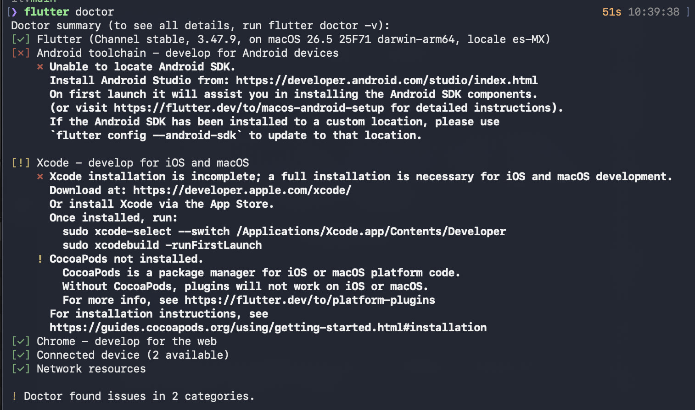

Se creó un proyecto con `flutter create entregas_ui` y se corrió en Chrome con `flutter run -d chrome`. **El contador se abrió y funciona para que cada vez que le des clic aumente en 1.** `flutter create` deja listo el proyecto con sus carpetas y archivos, y con `-d chrome` se le dice a Flutter que abra la app en el navegador.

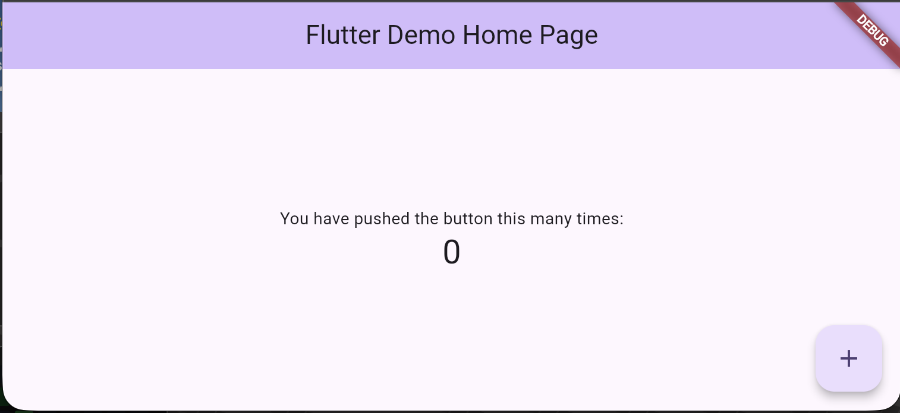

---

## StatelessWidget

*Archivo: `lib/ejemplos/01_stateless_folio.dart`*

En la pantalla solo se muestra el folio, si cambias los datos del folio lo que se muestra también se cambia.

---

## StatefulWidget

*Archivo: `lib/ejemplos/02_stateful_contador.dart`*

El botón Sumar aparece junto con el contador y funcionan perfectamente.

---

## Widgets básicos

### Esqueleto de pantalla

*Archivo: `lib/ejemplos/03_esqueleto_pantalla.dart`*

En la pantalla se muestra la opción para ingresar los datos de un nuevo pedido pero el botón para guardar los datos 

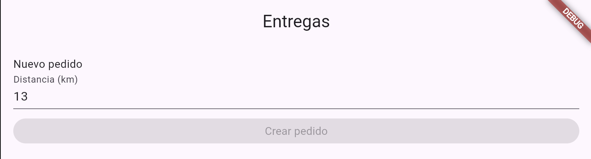

### Lista de pedidos

*Archivo: `lib/ejemplos/04_lista_pedidos.dart`*

Se muestran los folios que se tienen y si seleccionas uno, te avisa en la parte de abajo.

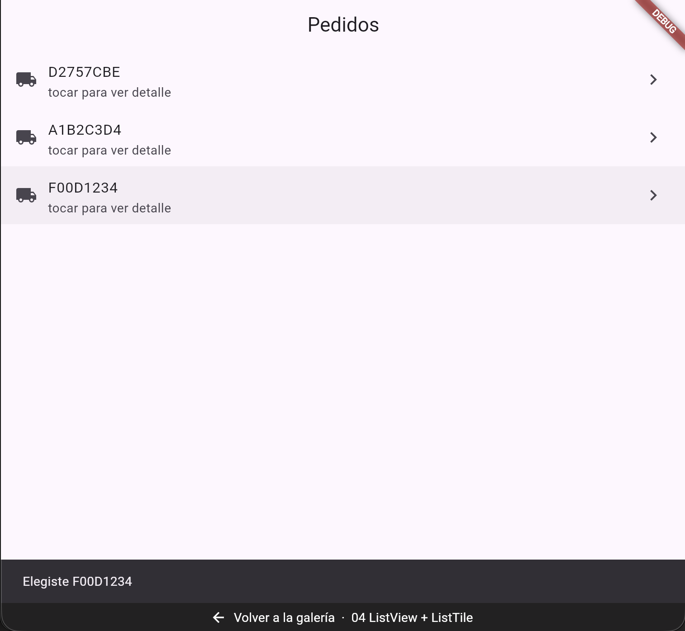

### Row + Expanded

*Archivos: `lib/ejemplos/05_row_expanded.dart` y `lib/ejemplos/05b_row_sin_expanded.dart`*

Con `Expanded`: En la parte de la izquierda se muestra el folio y en la parte de la derecha el medio, el `Expanded` hace que se vean en diferente columna.

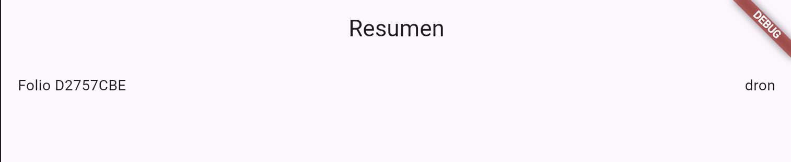

Sin `Expanded`: Lo que pasa es que se ve como si fuera una sola cadena de texto, además de causar un error en la terminal debido a que si la información es demasiado larga para la ventana ocurre un error de desbordamiento y se muestran franjas amarillas en la pantalla y un error en terminal.

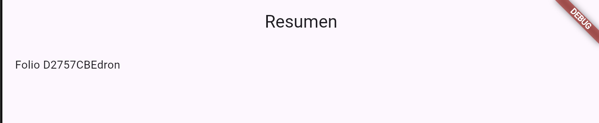

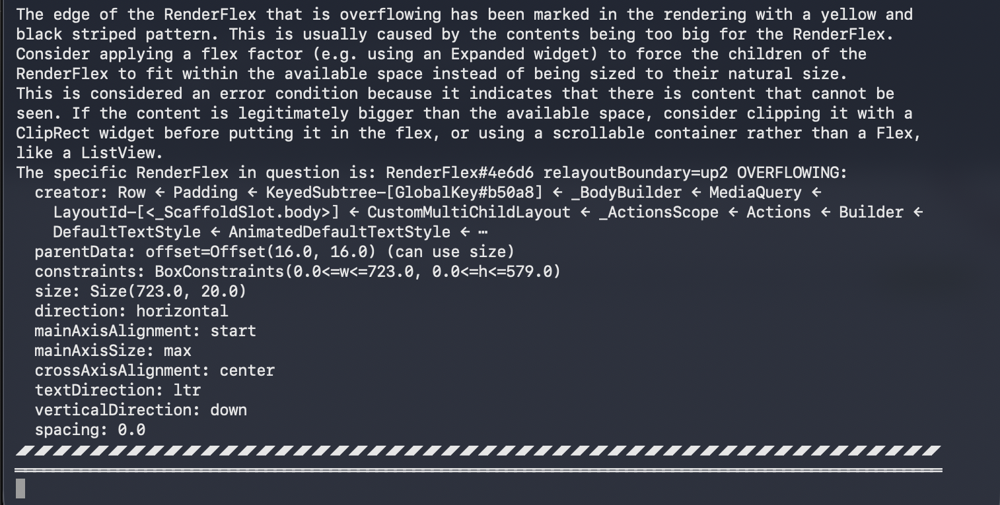

### Switch

*Archivo: `lib/ejemplos/06_switch.dart`*

El interruptor funciona y permite seleccionar dos estados como un botón de encendido y apagado.

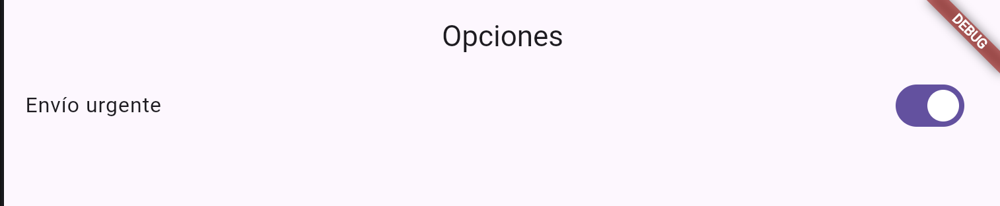

### Dropdown

*Archivo: `lib/ejemplos/07_dropdown.dart`*

En la pantalla se muestra una sección de selección de opciones, la cual al darle clic despliega las opciones disponibles para elegir.

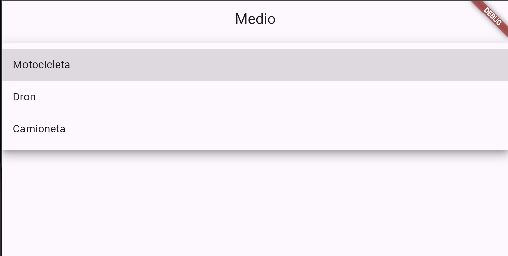

### AlertDialog

*Archivo: `lib/ejemplos/08_alertdialog.dart`*

El botón funciona bien, ya que al presionarlo aparece una nueva ventana que permite confirmar la acción; de ahí puedes elegir si continuar o cancelar, y si creas el pedido sale la alerta de creado.

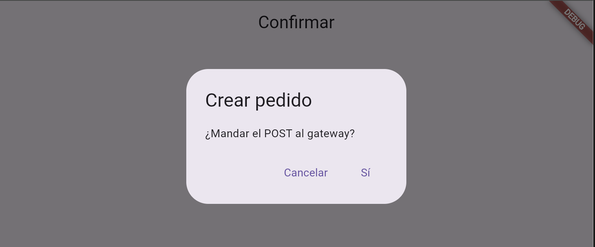

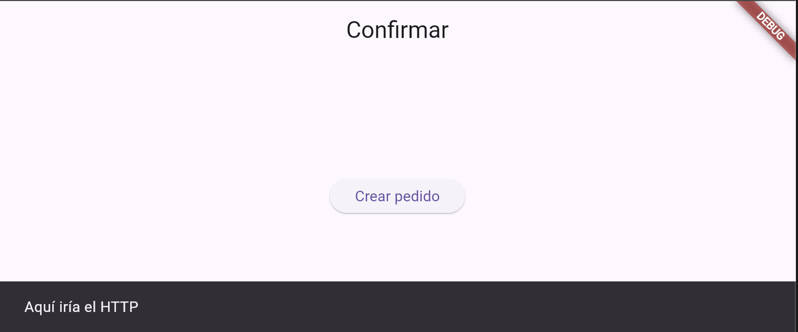

### Navigator

*Archivo: `lib/ejemplos/09_navigator.dart`*

En la primera pantalla se muestra un folio el cual se puede presionar para ir a otra ventana en la cual ven más detalles de este mismo folio seleccionado.

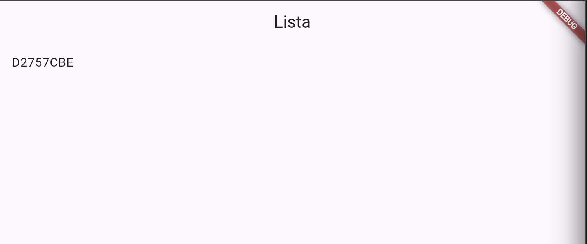

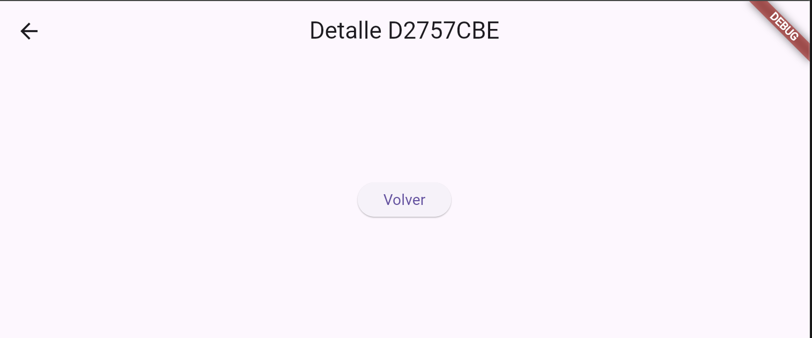

### CircularProgressIndicator

*Archivo: `lib/ejemplos/10_carga_progress.dart`*

Este es un simulado de cómo se vería cuando se carga un nuevo folio o se hace algún cambio: sale un círculo grande que gira y después de 1 segundo se genera o muestra la información.

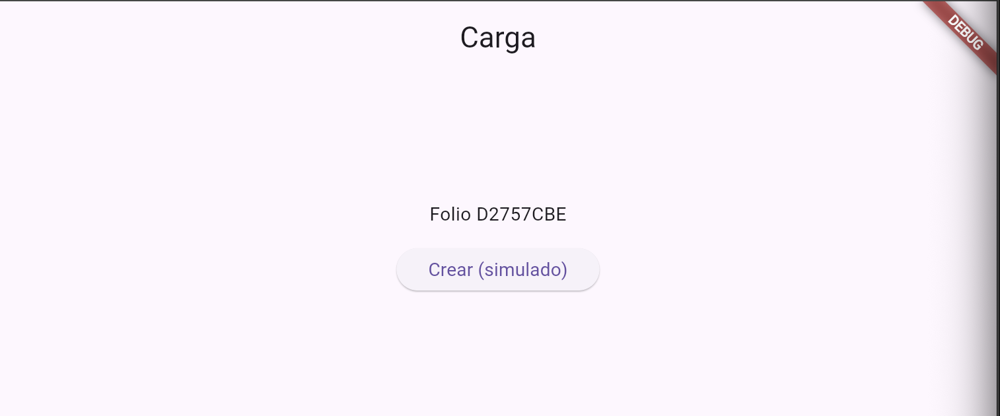

### Formulario con controladores (TextEditingController)

*Archivo: `lib/ejemplos/11_textediting_controller.dart`*

Los dos campos se muestran con una etiqueta que indica qué dato ingresar; además, el botón de crear muestra qué datos fueron ingresados en los campos.

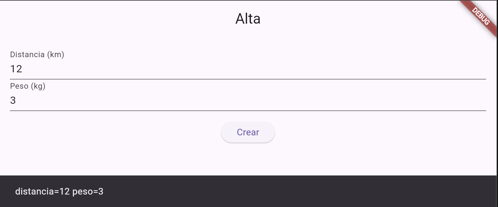

### Validación (Form + TextFormField)

*Archivo: `lib/ejemplos/12_form_validado.dart`*

El campo que se muestra está validado para que no se puedan ingresar datos erróneos; en este caso, como es distancia, no permite otra cosa que no sean números positivos.

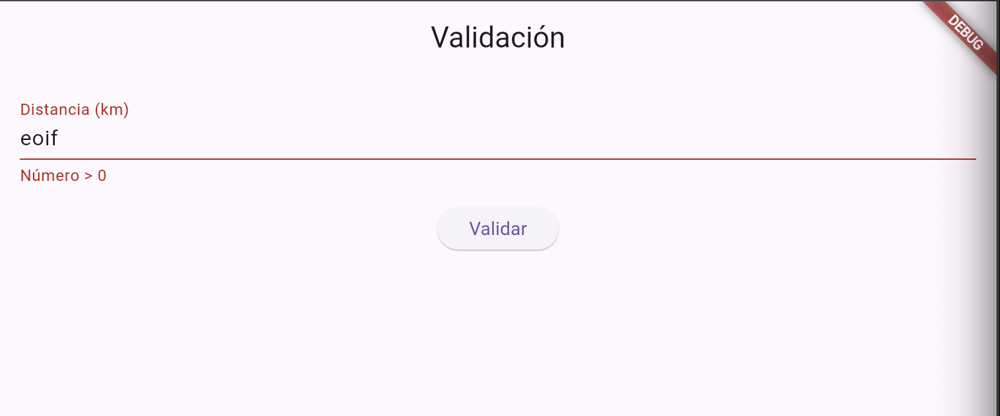

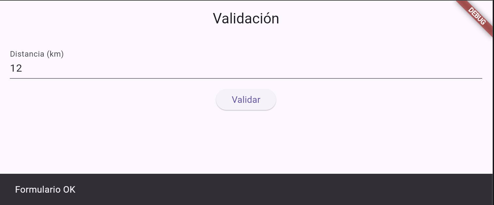

### Scroll (SingleChildScrollView)

*Archivo: `lib/ejemplos/13_scroll.dart`*

En la pantalla se muestra una lista de 20 pedidos para poder probar el scroll de la pantalla.

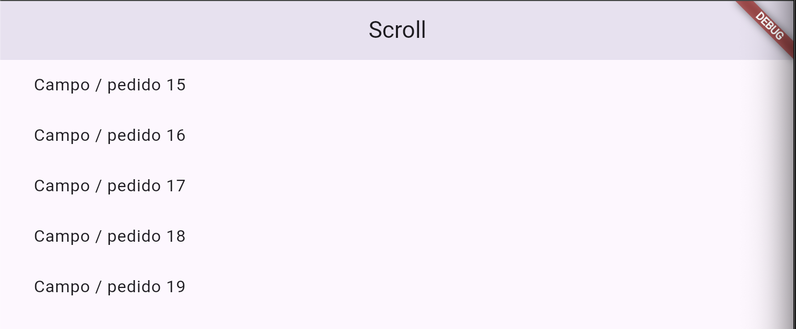

### BottomNavigationBar

*Archivo: `lib/ejemplos/14_bottom_navigation.dart`*

El menú inferior muestra dos opciones de navegación: uno que lista los folios y otro que permite agregar un folio nuevo.

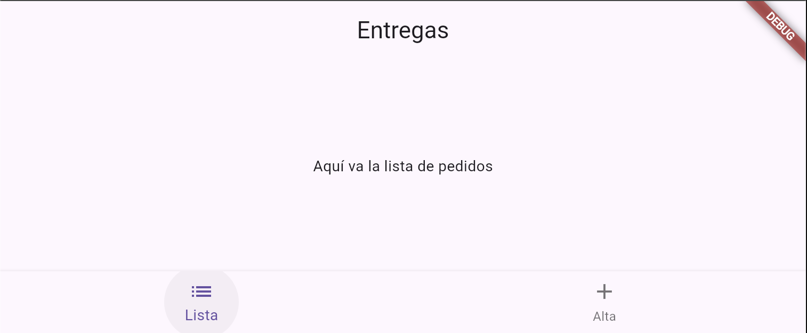

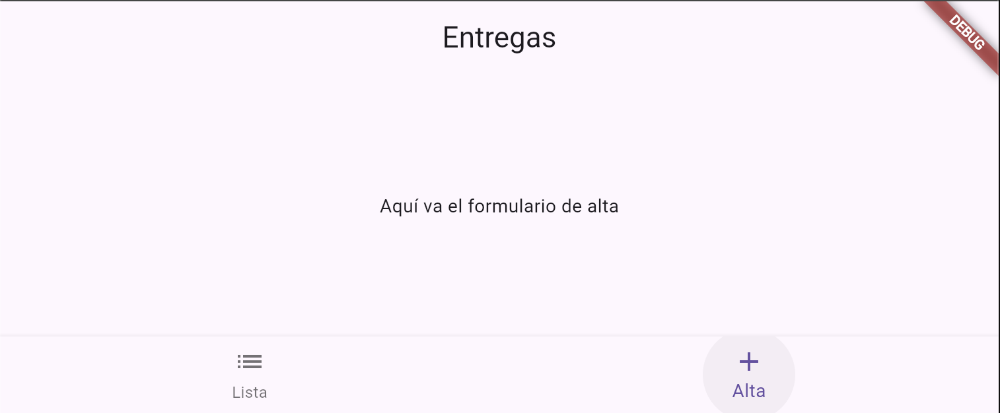

### Pestañas (TabBar)

*Archivo: `lib/ejemplos/15_tabs.dart`*

La pestaña de activos sería para los folios activos y el historial mostraría todos los folios del negocio.

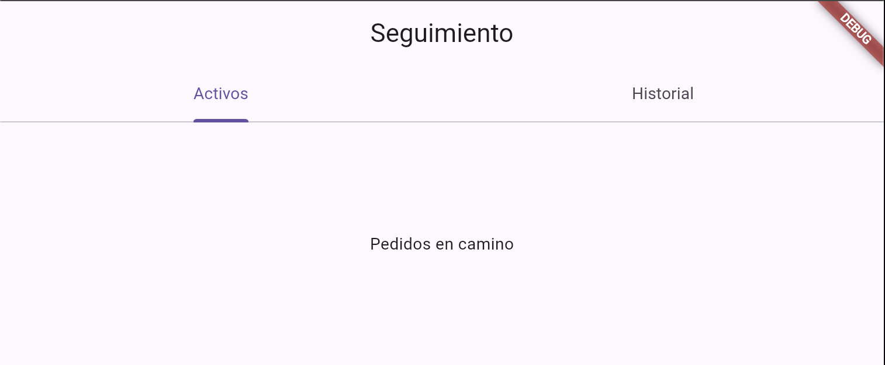

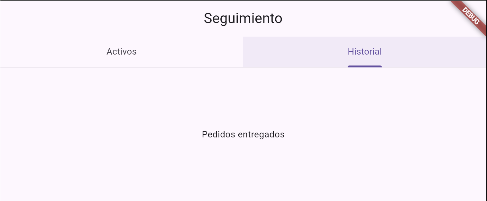

### Drawer

*Archivo: `lib/ejemplos/16_drawer.dart`*

Al presionar el botón de menú se abre el menú lateral, el cual tiene dos botones de navegación.

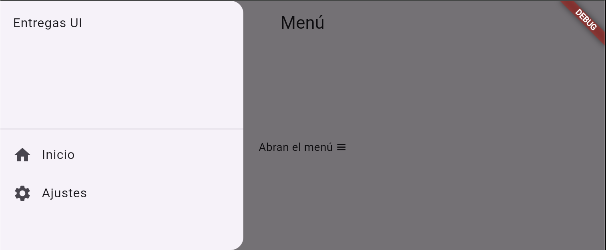

### FloatingActionButton

*Archivo: `lib/ejemplos/17_floating_button.dart`*

El botón puede ser presionado y serviría en un ejemplo real para agregar algún dato nuevo.

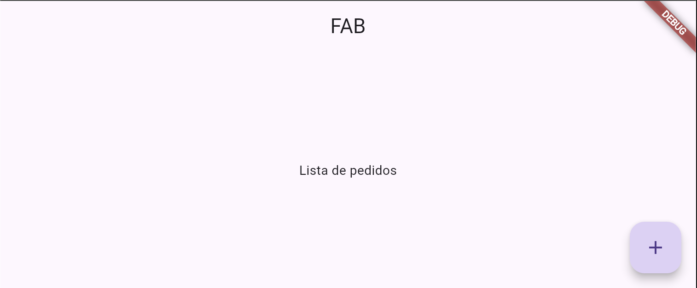

### Card + ListTile

*Archivo: `lib/ejemplos/18_card_pedido.dart`*

La tarjeta del folio muestra de manera resumida su información, facilitando su lectura.

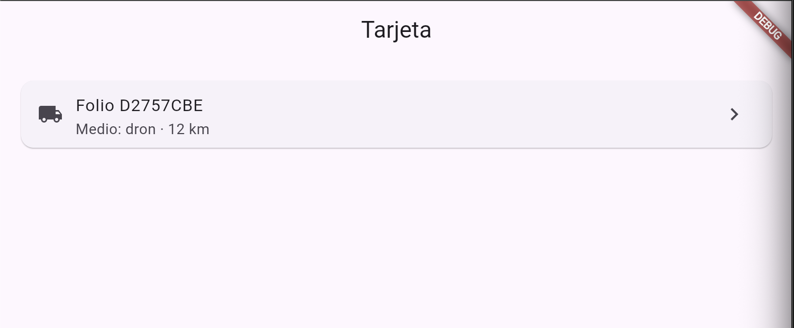

### RefreshIndicator

*Archivo: `lib/ejemplos/19_refresh_indicator.dart`*

La lista antes de recargar solo aparecen 2 folios, esto simula las actualizaciones en tiempo real ya que alguien más puede agregar datos; en Chrome el gesto de jalar hacia abajo no funciona bien.

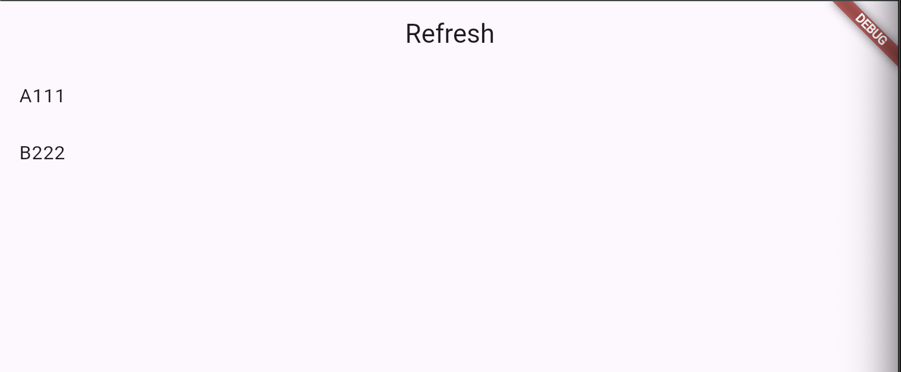

### FutureBuilder

*Archivo: `lib/ejemplos/20_future_builder.dart`*

Mientras llegan los datos aparece el círculo de carga y una vez finalizado se muestran los folios.

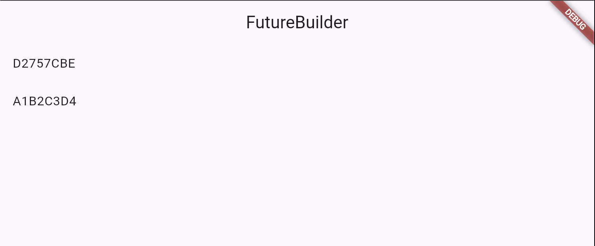

### POST con package:http

*Archivo: `lib/ejemplos/21_post_http.dart`*

En este caso falla el POST ya que no está corriendo ningún backend; sale el error con el motivo por el que falla.

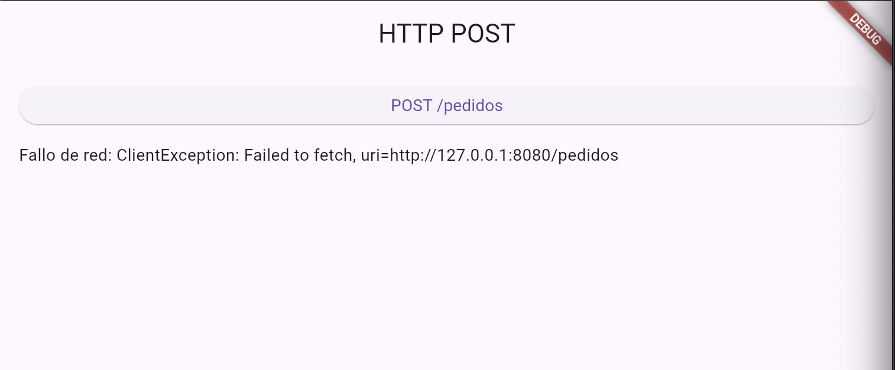

### Tema (ThemeData)

*Archivo: `lib/ejemplos/22_tema.dart`*

La paleta de colores cambió.

### GridView

*Archivo: `lib/ejemplos/23_gridview.dart`*

Los medios se visualizan en forma de tarjetas.

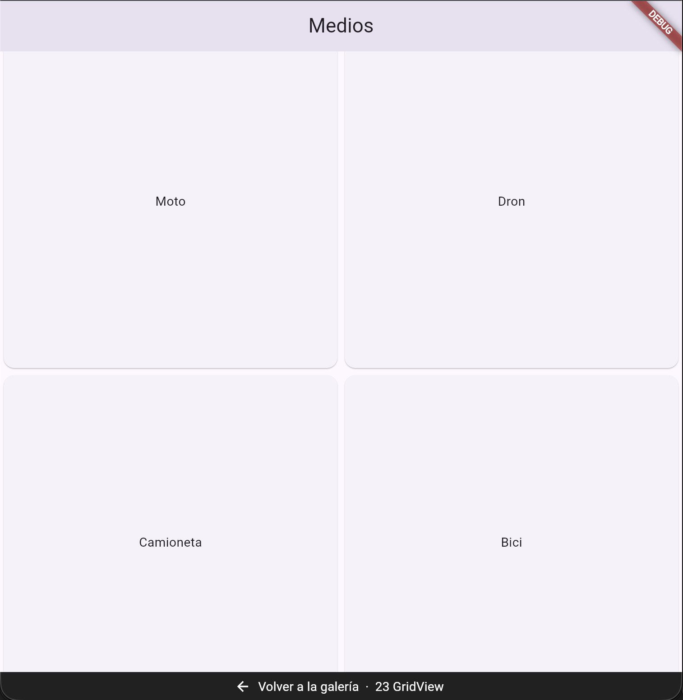

### Image.network

*Archivo: `lib/ejemplos/24_image_network.dart`*

La imagen carga después de unos segundos; en caso de que no pudiera, saldría el mensaje de error.

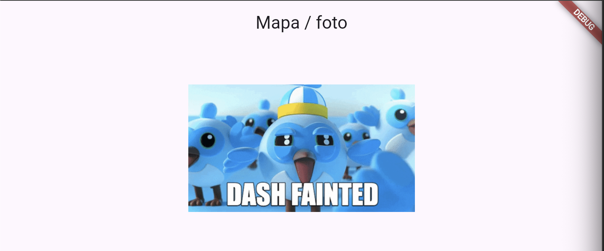

### SafeArea

*Archivo: `lib/ejemplos/25_safearea.dart`*

`SafeArea` sirve para que el contenido no quede tapado por las partes del sistema, como el notch (la muesca de la cámara), la barra de estado o la barra inferior de los celulares. Lo que hace es agregar automáticamente un espacio (padding) en esas zonas. En Chrome se ve igual que sin `SafeArea`: el texto «Contenido lejos del notch» aparece centrado, porque una computadora no tiene notch ni barras del sistema y no hay nada que esquivar. La diferencia solo se notaría en un celular o emulador que tenga notch.

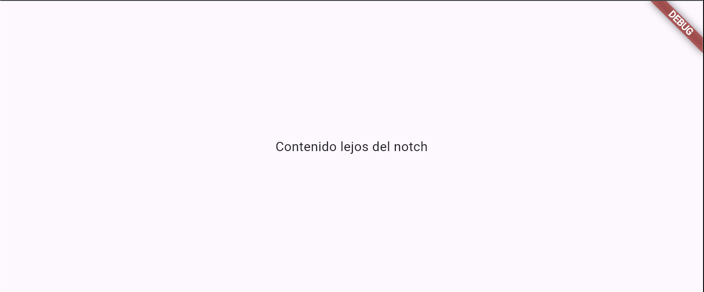

### Buscador con filtro

*Archivo: `lib/ejemplos/26_buscador.dart`*

El filtro busca folios que tengan la cadena de texto ingresada en el buscador, dejando visibles solo los pedidos que cumplen con lo que se pone en la búsqueda.

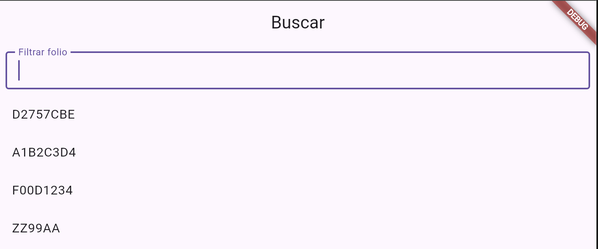

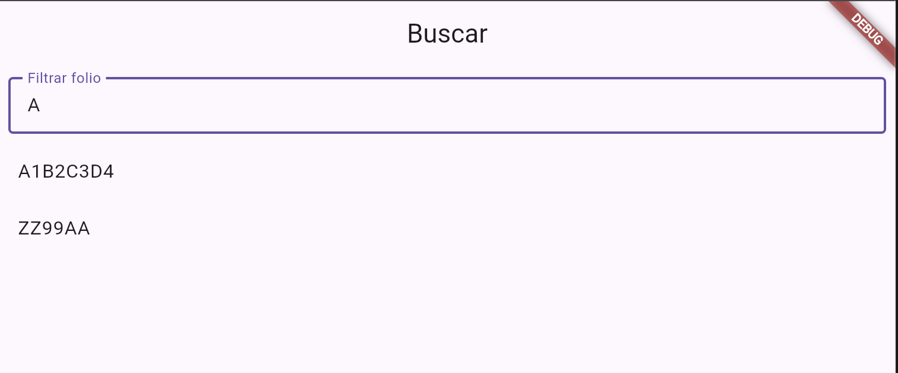

### Pantalla vacía

*Archivo: `lib/ejemplos/27_vacio.dart`*

En la pantalla se muestra cómo se vería si la parte de pedidos aún no tiene información, para cuando aún no hay pedidos registrados.

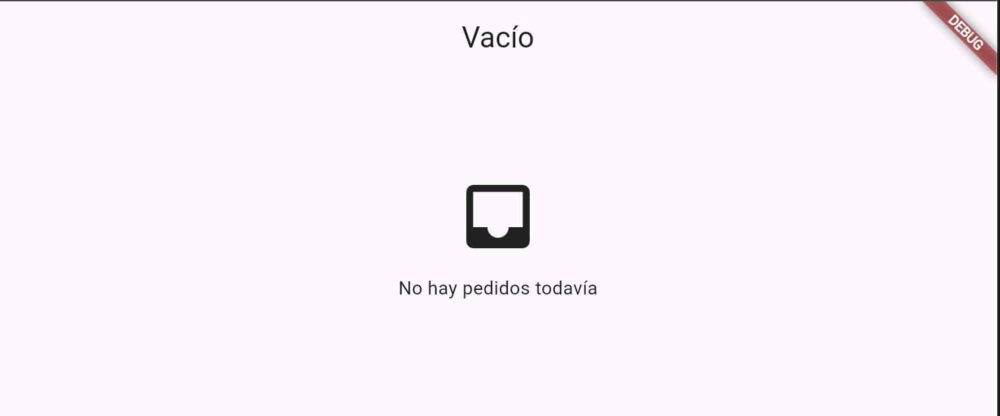

---

## Preguntas cortas

> **1. ¿Qué problema de mantenimiento ataca Flutter al existir web y móvil en el mismo producto?**

Sin Flutter habría que hacer una interfaz distinta para web, Android e iOS, con tres equipos y tres estilos, y cada cambio, por ejemplo cuando cambia el JSON del backend, habría que repetirlo en cada una. Con Flutter hay un solo código de interfaz, así que el cambio se hace una vez.

> **2. ¿Por qué Flutter dibuja sus propios controles en lugar de usar solo los nativos del sistema?**

Porque dibuja cada control con su propio motor (Skia o Impeller) en lugar de pedirle al sistema el botón de Android o de iOS. Así el equipo controla el diseño y la app se ve igual en cualquier dispositivo y en la web.

> **3. ¿En qué se diferencian un `StatelessWidget` y un `StatefulWidget`?**

El `StatelessWidget` no guarda estado: solo muestra los datos que recibe. El `StatefulWidget` guarda un `State` que puede cambiar, y al llamar `setState` Flutter vuelve a construir la parte afectada.

> **4. Si `flutter doctor` se queja del toolchain de Android pero Chrome está bien, ¿pueden empezar la clase de widgets igual? ¿Qué no podrán hacer todavía?**

Sí. En mi caso `flutter doctor` marcó problemas con Android (no tenía Android Studio) y con Xcode, pero Chrome salió bien, y pude correr todos los ejemplos en el navegador. Lo que no se puede hacer todavía es correr la app en un emulador o celular Android ni generar el `apk`. **[Ajusta este párrafo a lo que te pasó.]**

> **5. ¿Por qué un `Column` sin `Expanded` a veces «desborda» la pantalla cuando meten muchos hijos?**

Porque `Column` apila a los hijos cada uno con su propio tamaño. Si juntos miden más que el alto disponible, se salen de la pantalla y Flutter muestra la franja de desborde. Se arregla con `Expanded`, un `ListView` o envolviéndolo en un `SingleChildScrollView`.

> **6. ¿Qué widget usarían para mostrar muchos folios con scroll, y cuál para avisar «pedido creado» sin cambiar de pantalla?**

Para muchos folios con scroll, un `ListView` (con un `ListTile` por fila). Para avisar «pedido creado» sin cambiar de pantalla, un `SnackBar`.

> **7. ¿En qué se parece el ejemplo de `CircularProgressIndicator` a una llamada real al gateway?**

En el flujo: se marca que está cargando, se espera la respuesta y luego se muestra el resultado o el error. En el ejemplo la espera es falsa (`Future.delayed`); con el gateway real se cambia por la llamada HTTP (`http.post`) y el resto queda igual.
