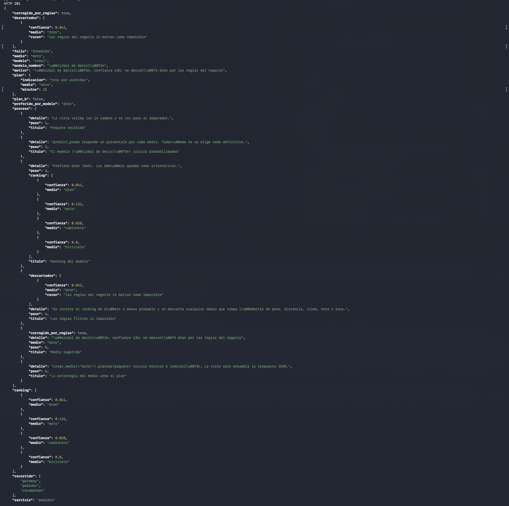
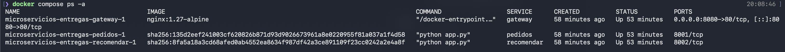
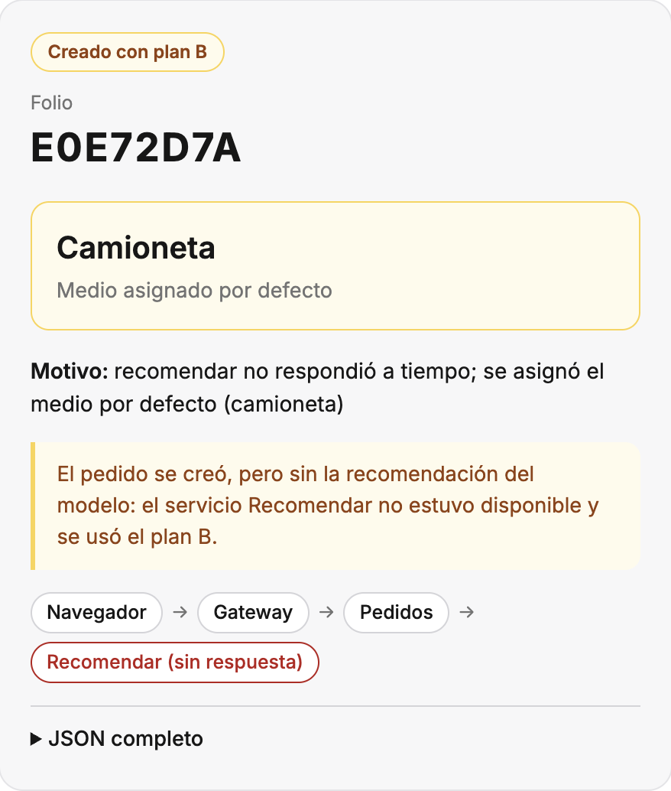
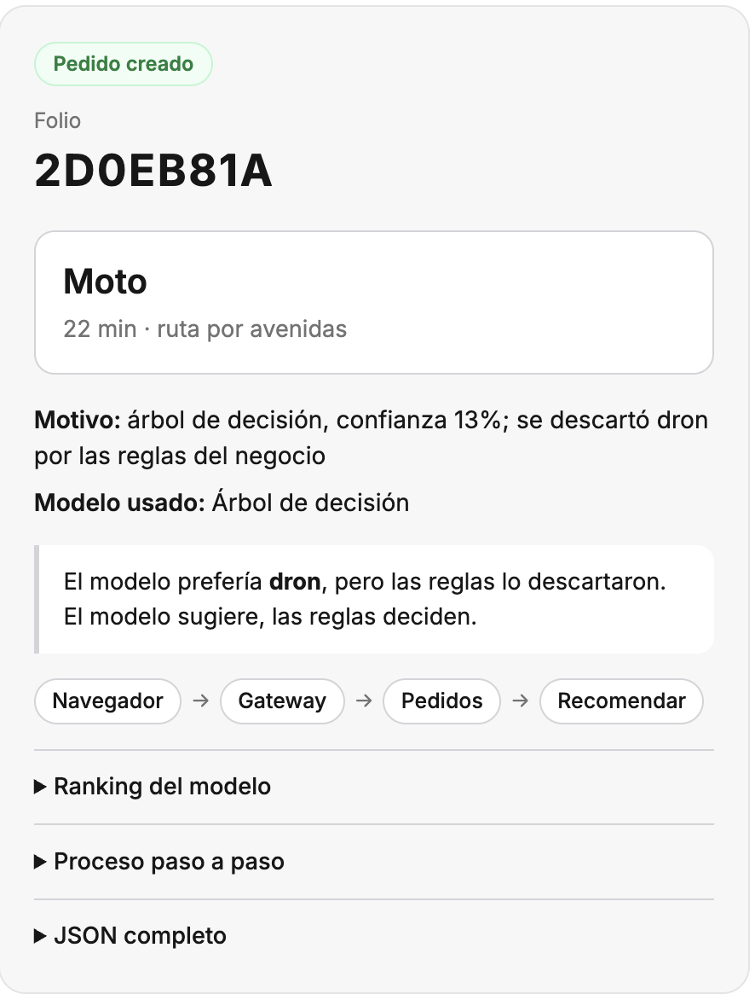
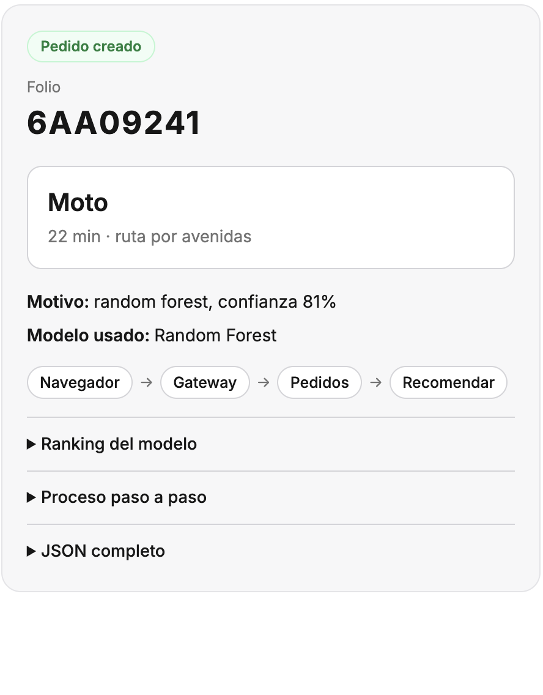
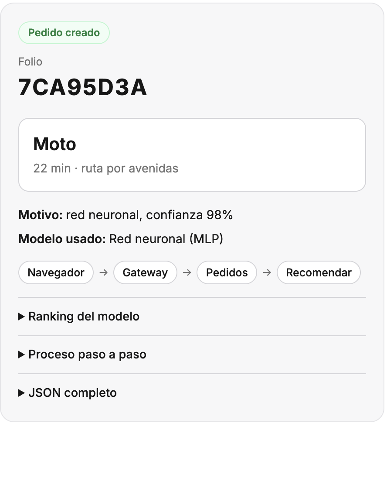

# Actividad — Microservicios con Docker

Nombre: Paulo Cesar Perez Martinez
Matrícula: 22121268
Equipo: <!-- nombre del equipo -->

## 1. Predicción (hora 3) vs resultado (navegador)

**Mi predicción (escrita antes de ver el resultado):**

- Medio que esperaba: Moto
- Por qué lo esperaba: que la moto es el modelo que mas entregas hace y no esta tan limitado a reglas de distancia 

**Resultado en el navegador:**

- Folio: 2D0EB81A
- Medio: Moto (22 min, ruta por avenidas)
- Motivo: árbol de decisión, confianza 13%; se descartó dron por las reglas del negocio
- Modelo usado: Árbol de decisión
- Preferido por el modelo / corregido por reglas: dron / sí (las reglas descartaron el dron)


**Mismo paquete con curl (POST /pedidos):**

```text
$ curl -s -o /tmp/respuesta.json -w "HTTP %{http_code}\n" -X POST http://127.0.0.1:8080/pedidos \
    -H "Content-Type: application/json" -d @paquete.json
$ python3 -m json.tool /tmp/respuesta.json

HTTP 201
{
    "corregido_por_reglas": true,
    "descartados": [
        {"confianza": 0.841, "medio": "dron",
         "razon": "las reglas del negocio lo marcan como imposible"}
    ],
    "folio": "59AAEA34",
    "medio": "moto",
    "modelo": "arbol",
    "motivo": "árbol de decisión, confianza 13%; se descartó dron por las reglas del negocio",
    "plan": {"indicacion": "ruta por avenidas", "medio": "moto", "minutos": 22},
    "plan_b": false,
    "preferido_por_modelo": "dron",
    "ranking": [
        {"confianza": 0.841, "medio": "dron"},
        {"confianza": 0.131, "medio": "moto"},
        {"confianza": 0.028, "medio": "camioneta"},
        {"confianza": 0.0,   "medio": "bicicleta"}
    ],
    "recorrido": ["gateway", "pedidos", "recomendar"],
    "servicio": "pedidos"
}
(se omite el arreglo "proceso" con los 6 pasos; la respuesta completa está en la captura)
```



**¿Coincidió con mi predicción?** Sí en el medio final: esperaba moto y el sistema recomendó moto, tanto en el navegador como con curl (mismo paquete, misma API; folios distintos porque son dos pedidos distintos). Pero no por el camino que yo pensaba: el árbol no prefería la moto, prefería **dron** (84.1 %). Las reglas del negocio descartaron el dron y la moto, con 13.1 % del árbol, fue la primera opción viable del ranking. Por eso salió `corregido_por_reglas: true`. El modelo sugiere y las reglas deciden.

## 2. docker compose ps (qué hay en cada contenedor)

```text
$ docker compose ps -a
NAME                                   IMAGE               COMMAND                  SERVICE      CREATED          STATUS          PORTS
microservicios-entregas-gateway-1      nginx:1.27-alpine   "/docker-entrypoint.…"   gateway      58 minutes ago   Up 53 minutes   0.0.0.0:8080->80/tcp, [::]:8080->80/tcp
microservicios-entregas-pedidos-1      sha256:135d2eef…    "python app.py"          pedidos      58 minutes ago   Up 53 minutes   8001/tcp
microservicios-entregas-recomendar-1   sha256:8fa5a18a…    "python app.py"          recomendar   58 minutes ago   Up 53 minutes   8002/tcp
```



- **gateway:** imagen oficial `nginx:1.27-alpine`, sin código mío. Sirve el `index.html` (el formulario) y enruta con `proxy_pass` las rutas `/pedidos`, `/sugerir`, `/salud/pedidos` y `/salud/recomendar` hacia los otros contenedores. Publica el puerto `8080:80`. Su `nginx.conf` y la carpeta `html/` se montan como volúmenes.
- **pedidos:** Flask en el puerto 8001. En `POST /pedidos` recibe el paquete, le pregunta a recomendar por HTTP (`RECOMENDAR_URL=http://recomendar:8002`), inventa el folio y guarda el pedido en una lista en memoria. **No lleva scikit-learn** porque nunca carga el `.joblib`: solo reenvía el paquete (incluido el campo `modelo`). Su `requirements.txt` solo tiene Flask y requests.
- **recomendar:** Flask en el puerto 8002. Contiene los tres `.joblib` (árbol, bosque y red) y `reglas.py`. En `POST /sugerir` valida los 14 campos, carga el modelo elegido, calcula el ranking y recorre las reglas hasta el primer medio posible. **No crea folios ni guarda pedidos**: su única responsabilidad es recomendar. Es el único que necesita scikit-learn, pandas y joblib.
- Solo el gateway publica puerto hacia mi computadora: en el `docker-compose.yml` solo el gateway tiene `ports: "8080:80"`. Pedidos y recomendar solo exponen 8001 y 8002 dentro de la red de Compose, donde se encuentran por nombre. Así el cliente conoce una sola dirección, los servicios internos no se pueden llamar directo desde fuera y se puede mover o reemplazar un servicio sin que el cliente se entere.

## 3. Fallo al apagar recomendar (qué mostró la página o el curl)

Comando usado: `docker compose stop recomendar`

- Qué mostró la página: Mostro el icono de recomendar en rojo hasta arriba
- Qué respondió el curl (código HTTP y cuerpo): código HTTP **503** en 0.007 s. El cuerpo trae el error `el servicio recomendar no estuvo disponible`, folio `19A88744`, medio `camioneta`, `modelo: null` y `plan_b: true`. El pedido sí se creó (tiene folio); el 503 solo avisa que recomendar falló. La respuesta fue casi inmediata porque con el contenedor detenido la conexión a `recomendar` falla al instante; la espera de 3 s de pedidos aplicaría si el servicio existiera pero no contestara.
- ¿Pedidos siguió vivo? Plan B usado: Si siguio vivo pero sale la camioneta y sale un mensaje de que el recomendador esta apagado
- Tras `docker compose start recomendar`: todo vuelve a la normalidad

Salida completa del curl con `recomendar` apagado:

```text
$ curl -s -o /tmp/plan_b.json -w "HTTP %{http_code} en %{time_total}s\n" -X POST http://127.0.0.1:8080/pedidos \
    -H "Content-Type: application/json" -d @paquete.json
HTTP 503 en 0.006969s
{
    "error": "el servicio recomendar no estuvo disponible",
    "folio": "19A88744",
    "medio": "camioneta",
    "modelo": null,
    "motivo": "recomendar no respondió a tiempo; se asignó el medio por defecto (camioneta)",
    "plan_b": true,
    "recorrido": [
        "gateway",
        "pedidos",
        "recomendar (sin respuesta)"
    ],
    "servicio": "pedidos"
}
```



## 4. Réplicas de la etapa 5 vs esto

En la etapa 5, el `docker-compose.yml` de la raíz levantaba `web` con `deploy.replicas: 3`: tres copias de la **misma imagen** (`plataforma-entregas`, el monolito Django con gunicorn), detrás de un balanceador nginx en el puerto 8000 y con una base Postgres. Las tres réplicas hacían exactamente lo mismo: formularios, recomendar, cotizar, etc. Eso es **escalar un monolito**, no separar responsabilidades: sigue siendo un solo código, una sola imagen y una sola unidad de despliegue. Si una réplica traía un error en su código, las tres lo tenían, y para dar más capacidad al modelo había que copiar toda la aplicación.

Aquí hay **tres contenedores con un rol distinto** y tres imágenes diferentes: gateway (nginx), pedidos (Flask + requests) y recomendar (Flask + scikit-learn). Cada uno se construye y se reinicia por separado, puede escalarse por separado y se comunica con los demás por HTTP. Por eso, si recomendar se cae, pedidos puede seguir respondiendo con un plan B (sección 3), algo que con las réplicas del monolito no tenía sentido, porque todas caían o funcionaban juntas.

## 5. Camino: navegador → … → modelo (red vs import)

```text
navegador ──HTTP──► gateway (nginx :8080) ──proxy_pass──► pedidos (Flask :8001)
                                                              │ requests.post(.../sugerir)
                                                              ▼
                                                    recomendar (Flask :8002)
                                                              │ joblib.load + reglas.py
                                                              ▼
                                                    modelo (.joblib) y reglas
(la respuesta JSON regresa por el mismo camino: recomendar → pedidos → gateway → navegador)
```

- **Con red (microservicios):** hay tres saltos de red: navegador → gateway, gateway → pedidos (`proxy_pass`, con `proxy_connect_timeout 2s`) y pedidos → recomendar (`requests.post`, con espera máxima de 3 s). Cada salto puede fallar: conexión rechazada, demora o ausencia de respuesta. Si recomendar no contesta o responde con error 5xx, pedidos responde 503 con el plan B (medio por defecto `camioneta`). Si el que no contesta es pedidos, el que se queja es el gateway (un error 502/504 de nginx).
- **Con import (monolito Django):** la vista `recomendar` llama a `obtener_recomendador().sugerir(paquete)` en el mismo proceso. Es una llamada a función: no hay red, no hay timeout ni plan B, y el modelo siempre está "disponible" mientras Django esté vivo. Es más rápido, pero el modelo y la aplicación viven y fallan juntos.

## 6. Si solo cambia el .joblib, ¿qué reconstruyen?

Solo se reconstruye la imagen de **recomendar**, porque los `.joblib` están únicamente en `recomendar/modelo/`:

```bash
docker compose up -d --build recomendar
```

La imagen de **pedidos** no cambia: no contiene ningún modelo. El **gateway** tampoco: usa la imagen oficial de nginx y su configuración y su HTML se montan como volúmenes. Además, como en el `Dockerfile` el `pip install` va antes de `COPY . .`, Docker reutiliza la capa de dependencias y solo vuelve a copiar el código y los modelos, así que el rebuild es rápido.

En el monolito Django el modelo viaja dentro de la misma imagen que todo lo demás (`COPY . .`), así que cambiar un `.joblib` obligaba a reconstruir la imagen completa y a reemplazar las tres réplicas de `web`.

## 7. Dos límites de esta práctica antes de producción

Falta, antes de poner esto en producción:

1. **Persistencia de los pedidos.** Pedidos los guarda en una lista de Python en memoria (`PEDIDOS = []`). Si el contenedor se reinicia, se pierden todos los folios, y si se levantaran dos copias de pedidos cada una tendría su propia lista y un folio solo existiría en una. Faltaría una base de datos compartida (por ejemplo PostgreSQL, como en el monolito de la etapa 5).
2. **Servidor y arranque preparados para producción.** Los servicios corren con el servidor de desarrollo de Flask (`app.run`, el mismo que avisa "This is a development server") y no con un servidor WSGI como gunicorn. Además, `depends_on` solo ordena el arranque; no espera a que recomendar esté realmente listo (carga scikit-learn y calienta el árbol al iniciar, y el código documenta que eso tarda unos 4 segundos, más que la espera de 3 s de pedidos). Faltarían un servidor de producción y *healthchecks* para que el arranque espere a que cada servicio esté sano.

## 8. ¿En qué se parece y en qué no el HTML al del monolito Django?

**Se parece** en lo que ve el usuario: un formulario con los campos del paquete, un selector de modelo y una pantalla con el resultado (medio, motivo, folio). Es el mismo estilo de formulario.

**No se parece** en lo que hay detrás, y la arquitectura no es la misma:

- **Quién sirve la página:** la del monolito (`cliente.html`) la entrega Django desde `/entregas/cliente/`. Esta es un archivo estático que sirve nginx en el gateway.
- **A quién le habla:** la del monolito llama a rutas de Django (`/entregas/...`, por ejemplo `/entregas/cotizar/`). Esta solo hace `fetch("/pedidos")` y `/salud/...` al gateway, sin poner host ni puerto de pedidos ni de recomendar.
- **Dónde viven las reglas y el modelo:** en el monolito, dentro del proceso de Django. Aquí, en el contenedor de recomendar; el HTML no tiene ninguna regla de negocio y pedidos tampoco.
- **Qué puede salir mal:** en el monolito la recomendación es una llamada a función. Aquí es una cadena de llamadas por red, así que la página debe saber mostrar un error o el plan B (por eso incluye el recorrido y un botón de salud).

## 9. Misma hora 3 con árbol, bosque y red: ¿coincidieron?

Mismo paquete de noche (hora 3) con los tres modelos:

| Modelo | Medio recomendado | Confianza | Preferido por el modelo | ¿Corregido por reglas? | Motivo |
|---|---|---|---|---|---|
| Árbol | Moto | 13 % | Dron (84.1 %) | Sí | Las reglas descartaron el dron; la moto fue la primera opción viable |
| Random Forest (bosque) | Moto | 81 % | Moto | No | random forest, confianza 81 % |
| Red neuronal | Moto | 98 % | Moto | No | red neuronal, confianza 98 % |





**Comentario:** Sí coincidieron en lo importante: los tres modelos recomendaron **moto** (22 min, ruta por avenidas), así que el medio no cambió. Lo que sí cambió fue el camino y la confianza. El árbol prefería **dron** con 84.1 %, pero las reglas lo descartaron porque la hora 3 cae en la noche (antes de las 6, el dron no puede volar); ahí la moto quedó con solo 13 % y el pedido salió "corregido por reglas". El bosque (81 %) y la red neuronal (98 %) ya preferían moto por su cuenta, así que las reglas no tuvieron que corregir nada y el motivo no menciona ningún descarte. La red es la que más segura se muestra, pero mayor confianza no significa más acierto: solo dice qué tan inclinado está el modelo hacia su respuesta. Esta práctica deja claro por qué las reglas van aparte del modelo: el árbol, por sí solo, habría mandado un dron de noche.
